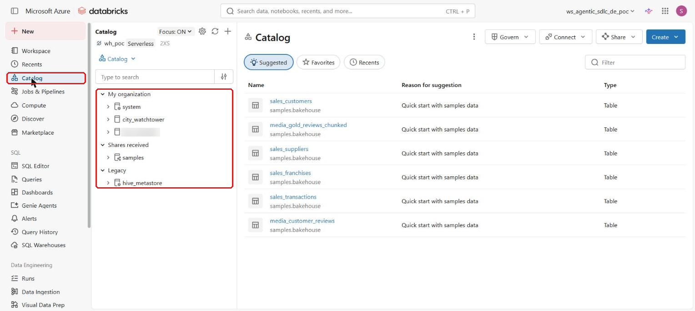
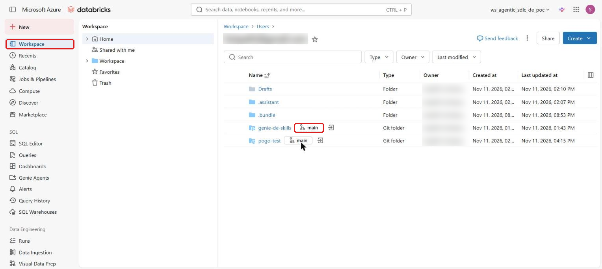
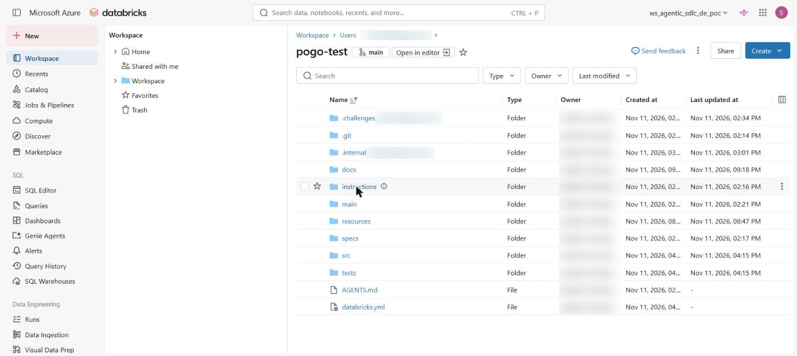
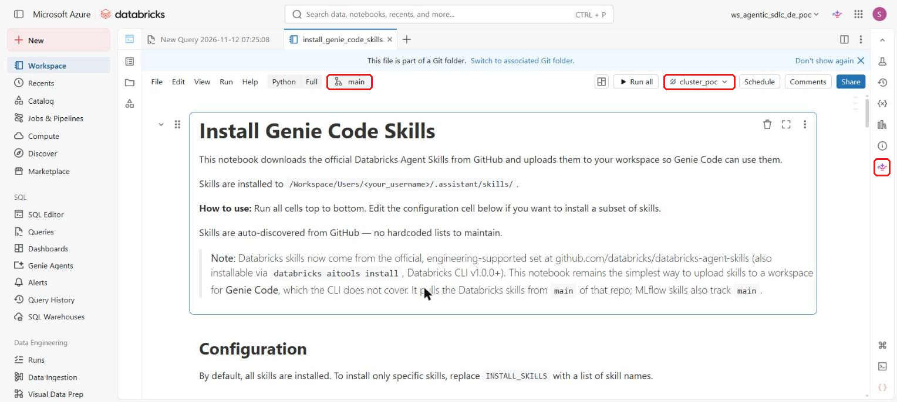
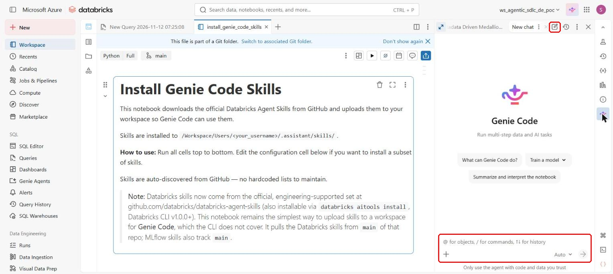
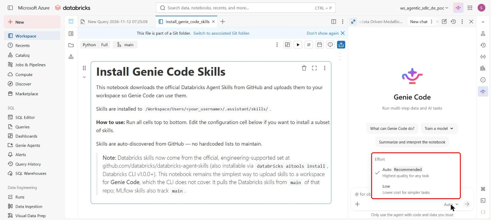
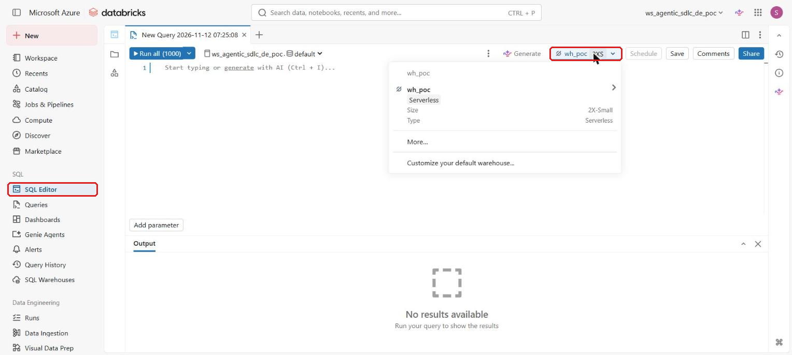
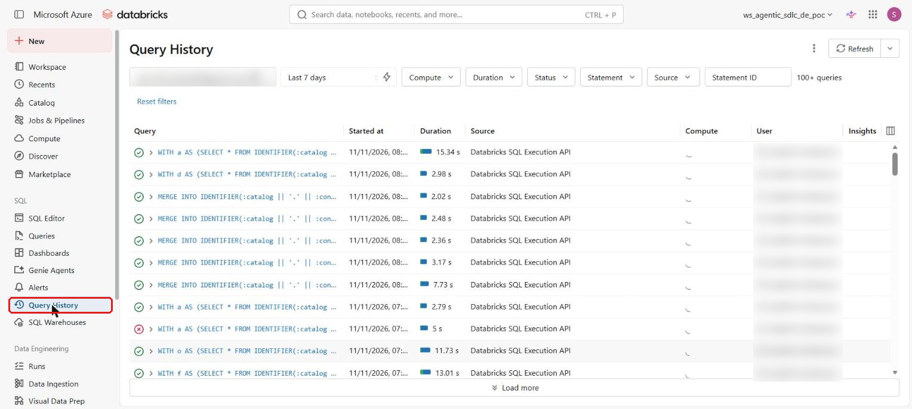
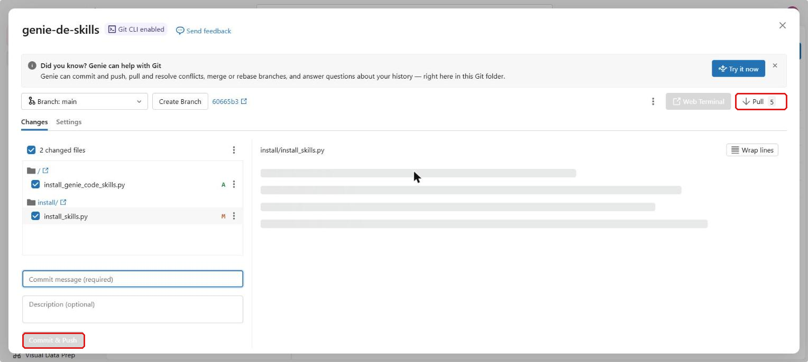
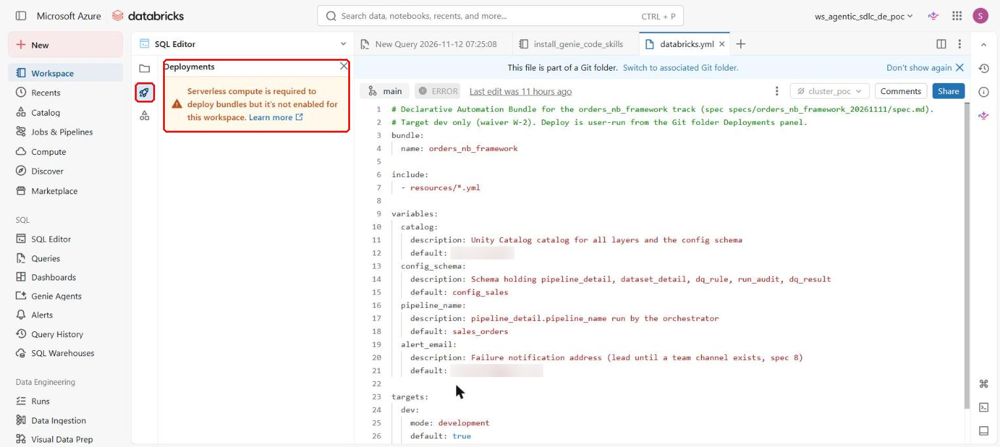

# 0. Basics: read this first if you are new

This page is for you if your Databricks knowledge is a short intro class: you can open a notebook, run a cell and run a
`SELECT` on a table. It explains the words and screens the rest of the guide uses. It takes about 15 minutes.

If something on the screen looks different from what is written here, ask your lead. Databricks changes its screens
from time to time.

## 1. Two places: dev and prod

Most companies keep two (or more) copies of their Databricks setup:

| Name | What it is | Can you break things there? |
|---|---|---|
| **dev** (development) | a safe place to build and try things | yes, that is what it is for |
| **prod** (production) | what the business really uses: real reports, real users | no; only a person, after checks, puts work there |

You and the agent work **only in dev**. In our example the dev data lives in a catalog called `dev_shop`. A name that
starts with `dev_` is dev. If a name does not start with `dev_`, treat it as prod and do not change it.

## 2. Where data lives

Databricks keeps data in **Unity Catalog**, in three levels, like folders:

```
catalog   ->  schema   ->  table
dev_shop  ->  gold_sales -> fact_orders        full name: dev_shop.gold_sales.fact_orders
```

- **Table**: rows and columns, the thing you run `SELECT` on.
- **View**: a saved query that looks like a table but stores no data of its own.
- **Volume**: a folder for **files** (CSV, JSON, images) inside a catalog and schema. Example:
  `/Volumes/dev_shop/raw/orders/` holds the daily order files before they become tables.

To look around: left sidebar > **Catalog** (Catalog Explorer). You can see catalogs, schemas, tables, volumes, who owns
them and their descriptions.



## 3. What runs your code: compute

| Name | What it is | When you see it |
|---|---|---|
| **SQL warehouse** | compute that runs only SQL. Starts fast. | the agent runs its checks here. Your lead tells you which one is your team's |
| **Cluster** (also "classic compute") | a group of machines you or an admin chose, running Python, SQL and more | older or special workloads |
| **Serverless** | compute that Databricks starts and sizes for you. You do not choose machines | most new work |
| **All-purpose cluster** | a cluster people share for notebooks | not meant for scheduled work (costs more) |

**DBU** (Databricks Unit) is how Databricks measures usage for billing: more or bigger compute for longer = more DBUs
= more cost.

## 4. What gets built

| Word | Plain meaning | ShopCo example |
|---|---|---|
| **Pipeline** | a set of steps that turns raw data into clean tables, run by Databricks (Lakeflow) | daily files -> bronze -> silver -> gold tables |
| **Job** | a scheduled run of something (a pipeline, a notebook), for example every day at 06:00 | "run the ShopCo pipeline daily" |
| **Medallion layers** | **bronze** = raw data as it arrived; **silver** = cleaned, one table per business thing; **gold** = ready for reports | `bronze_sales.orders` -> `silver_sales.orders` -> `gold_sales.fact_orders` |
| **Fact table** | events with numbers you add up | `fact_orders`: one row per order line, with amount |
| **Dimension table** | descriptions you group or filter by | `dim_customer` (name, country), `dim_date` |
| **Stream / streaming** | read only the **new** rows since last time, instead of all rows every time | the pipeline reads only today's new files |
| **Auto Loader** | the Databricks feature that picks up new files from a folder automatically | loads each new order file once |
| **Bundle** | a few settings files (`databricks.yml`) that tell Databricks what to create in dev and in prod | "create the ShopCo pipeline and its daily job" |
| **Deploy** | create or update those things in a workspace from the bundle | press Deploy for `dev` |

## 5. Where your project files live: Git folder

A **Git folder** is a folder in the workspace that keeps a history of every change, shared with your team.

| Word | Plain meaning |
|---|---|
| **Pull** | get your teammates' latest changes |
| **Commit & Push** | save your changes into the shared history, with a short message |
| **Branch** | your own line of changes; usually you stay on the one your lead tells you |
| **Merge / pull request (PR)** | the step where your changes are reviewed and joined into the main version |

Your lead gives you the path of the project's Git folder (for example `/Users/<lead>/shopco-orders`). Open it from the
left sidebar > **Workspace**. A Git folder has a small branch button (for example `main`) next to its name.



Inside, a project made with this kit looks like this (`specs/`, `src/`, `resources/`, `databricks.yml` and your own
`.internal_...` and `.challenges_...` folders; [page 5](05-files-and-folders.md) explains each):



## 6. Where to click

| What | Where |
|---|---|
| **Genie Code** (the AI assistant) | the sparkle icon in the thin bar on the right edge of a notebook or file (also at the top right, next to the workspace name). The panel says "Run multi-step data and AI tasks": it can run steps for you and asks first. Chat from a **notebook in your project folder** with your warehouse attached (create an empty one if needed, for example `chat`). Leave **Effort** (the drop-down next to the send arrow) on **Auto** |
| **New chat** | the pencil-on-paper icon at the top of the Genie Code panel. Start a new chat for each new piece of work |
| **Accept all** | after the agent writes or changes files, they show as pending. Click **Accept all**, or the changes are lost |
| **Allow / Skip** | the agent asks before it runs anything. See the safety rules below |
| **Compute selector** | the drop-down at the top right of a **notebook** or the SQL editor (plain files like `AGENTS.md` have none). In a new SQL query it says **Connect** until you choose. Choose your team's SQL warehouse |
| **SQL editor** | left sidebar > **SQL Editor**. Paste a query, choose your warehouse, click **Run** |
| **Query History** | left sidebar > **Query History**. Every query that ran, with its status and time |
| **Git dialog** | click the branch button (for example `main`): next to the Git folder's name in the Workspace browser, or at the top of any file in it. There you **Pull**, see changes, and **Commit & Push** |
| **Deployments** (rocket icon) | open `databricks.yml` in the Git folder; the rocket icon in the thin bar on the left of the editor opens the panel where you choose `dev` and click **Deploy**. It needs serverless: without it the panel says so, and the agent creates dev jobs another way |

### What these screens look like

Screenshots from a real workspace (names and emails blurred). Red boxes mark what to click. Your screens may differ a
little.

**A notebook**: the branch button (Git dialog), the compute selector, and the Genie Code icon on the right edge.



**The Genie Code panel**: the new-chat icon at the top, the message box at the bottom.



**Effort**: leave it on **Auto**. (There is no separate "agent mode" switch: the panel already runs steps.)



**SQL Editor**: the compute selector at the top right; choose your team's warehouse before **Run**.



**Query History**: every query, its status (green tick or red cross), and how long it took.



**Git dialog**: **Pull** at the top right gets your team's changes (the number is how many are waiting); write a
message and click **Commit & Push** at the bottom left to share yours.



**Deployments**: the rocket icon on `databricks.yml`. In this workspace serverless is off, so the panel shows a
warning instead of the **Deploy** button.



## 7. Two safety rules

**Rule 1: Allow or Skip?** Genie Code asks before it runs anything. This is the one rule for every prompt; other
pages link here.

| What the prompt shows | Do |
|---|---|
| you cannot see the full SQL or code | **Skip**, and type "print the full SQL first" |
| SQL that only reads: starts with `SELECT`, `SHOW`, `DESCRIBE` or `LIST` (also on `system.` tables) | **Allow** |
| SQL that creates or changes tables (`CREATE`, `ALTER`, `INSERT`, `UPDATE`, `MERGE`) while the agent is working on a task you approved, and every catalog in it is a dev catalog (starts with `dev_`; a name without a catalog, like `bronze_sales.orders`, uses the dev catalog you chose) | **Allow** |
| writing or changing files inside your project folder, or under `/Volumes/dev_...` | **Allow** |
| Python code or an API call (for example creating a pipeline or job) during an approved task, and its description mentions only dev names | **Allow**; if you do not understand what it does, **Skip** and ask |
| any name that is not dev (does not start with `dev_`), or the words `DROP`, `DELETE`, `TRUNCATE`, `GRANT`, `REVOKE`, `OWNER` | **Skip** and ask your lead |
| anything before you replied `approved` to a spec, other than reading | **Skip** and ask |
| you are still not sure | **Skip** and ask. Skipping is always safe; the agent waits |

**Rule 2: how to check a Validate note.** After each task the agent shows a check like this:
```
Validate: SELECT count(*) FROM dev_shop.bronze_sales.orders     Expected: 8
```
Copy the SQL, open the **SQL Editor**, choose your team's warehouse, click **Run**, and compare the result with
"Expected". Same number: reply `ok`. Different: reply `fix` and say what you saw.

## 8. Other words you may meet

| Word | Plain meaning |
|---|---|
| **GA / Preview / Beta** | how finished a Databricks feature is. GA = fully released; Preview or Beta = still being tested. The agent prefers GA |
| **System tables** | tables Databricks fills itself, with usage, cost and history. Your admin must give access |
| **Quota** | a limit on how many machines your company may use at once in the cloud |
| **Tag** | a label on a table or column, for example `sensitivity = restricted` |
| **Mask** | a rule that hides a column's real value (for example an email) from people not allowed to see it |
| **Owner / steward** | the group responsible for a table / the people who look after its meaning and quality |
| **Grain** | what one row of a table means, for example "one row per order line" |
| **SCD 1 / SCD 2** | keep only the latest value / keep every change with dates (for example a customer moving country) |
| **Spec** | the short written plan the agent writes and you approve before anything is built (see page 1) |

Now read [page 1](01-what-is-this.md), then the steps marked for engineers on [page 3](03-first-task.md).
