# 10. Skills in action: what each skill looks like in Genie Code

Every skill was run once in a real workspace (12 November 2026, kit installed with `install/install_skills`,
`32 ok, 0 failed`). Each picture shows the prompt, the **"Read de-... skill"** step that proves the right skill
loaded (red box), and the start of the answer. Names and emails are blurred. The example project is a small orders
pipeline, like ShopCo on [page 3](03-first-task.md).

How the test was run:
- one **new** Genie Code chat per skill, prompt typed in plain words (no `@`), Effort **Auto**;
- SQL and Python ran only on a Unity Catalog cluster (`cluster_uc_dev`, Dedicated access mode), never on serverless
  or a SQL warehouse, because the prompt said so;
- every **Allow** was checked first with the rule on [page 0](00-basics.md#7-two-safety-rules): only reads were
  allowed; "chat answer only, no files" kept the test from writing project files.

Read a picture like this: under your message, Genie Code lists its steps. The first step should be
`Read de-<skill> skill`. After it finishes, the steps fold into "N steps"; click it to see them again.

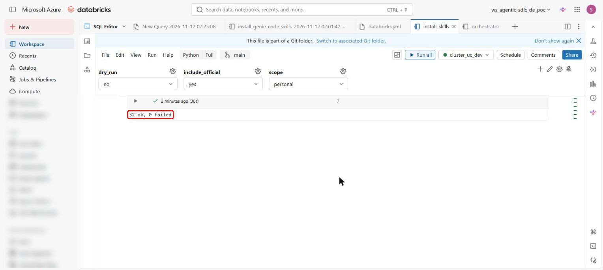

## Results

| Skill | Prompt (short) | Loaded by itself? | Result |
|---|---|---|---|
| `de-databricks-current` | "new name for Delta Live Tables? convert this DLT code" | yes | current `dp.` syntax and AUTO CDC |
| `de-env-check` | "check this workspace's readiness" | yes | capability table; fixed: it no longer suggests the CLI |
| `de-advisor` | "Auto Loader or Lakeflow Connect for daily JSON files?" | yes, after the fix (was no) | recommendation, when the other option wins |
| `de-cost` | "monthly cost of a 20-minute daily pipeline, classic vs serverless" | yes | per-run and monthly cost table from the price file |
| `de-data-modeling` | "star schema for orders and payments: bus matrix and grain" | yes | grains, keys, rules, open questions |
| `de-ontology-design` | "concepts, properties and relationships in the sales tables" | yes | concepts, properties, vocabularies with evidence; fixed: fewer approvals |
| `de-data-governance` | "governance audit of the dev catalog" | yes; plain "which tables have no description" after the fix | findings with check ids (G01..G22) and evidence |
| `de-data-contract` | "drop the region column: what breaks downstream?" | yes | breaks / safe / order of change / rollback |
| `de-quality-testing` | "data quality rules for a silver payments table" | yes | rule table with ids and quarantine reasons |
| `de-sdd-spec` | "new requirement: payments CSV into bronze, silver, gold" | yes | clarifying questions with recommended answers, `defaults` |
| `de-goldfish-review` | "goldfish review of the track's spec" | yes | what it read, comprehension paraphrase, findings, verdict |
| `de-sdd-implement` | "implement the next task (dry run)" | yes | next task and its Validate plan; nothing claimed or run |
| `de-sdd-tracking` | "where are we on the track? who did what?" | yes | status, what is left, ledger mismatches |
| `de-release-gate` | "ready for production? go or no-go" | yes | scorecard and NO_GO with blockers; fixed: no CLI advice |
| `de-run-diagnose` | "explain this stack trace" | **no** for a simple pasted error; yes with `@de-run-diagnose` | see the tip below |
| `de-spark-runtime` | "DBR 15.4 to 18 LTS: is input_file_name still supported?" | yes | answer from the dated runtime reference |

**Tip: when the skill does not load by itself.** For a short question Genie Code sometimes answers on its own,
without the skill (seen with a simple pasted error). The answer can still be right, but it skips the kit's checks
and records. To force the skill, type `@` and the skill name, and pick the row that shows the skill's description
(not the folder rows), then your question:

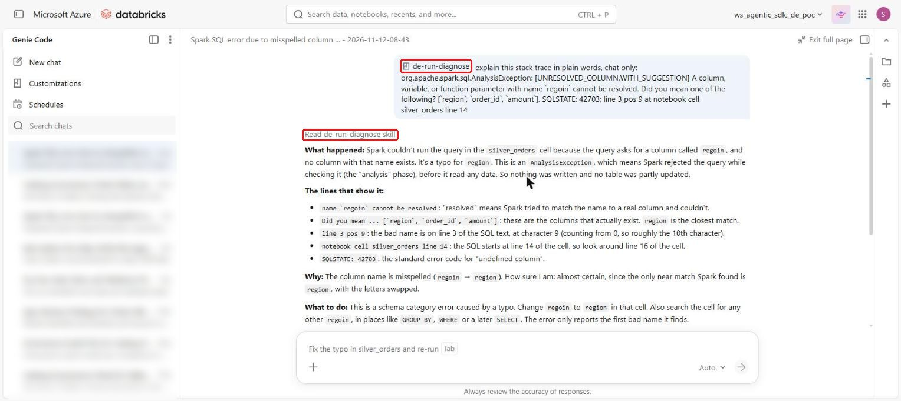

## Pictures per skill

### Plan and build
`de-sdd-spec`: asks questions in rounds, each with a recommended answer; reply `defaults` to accept them.
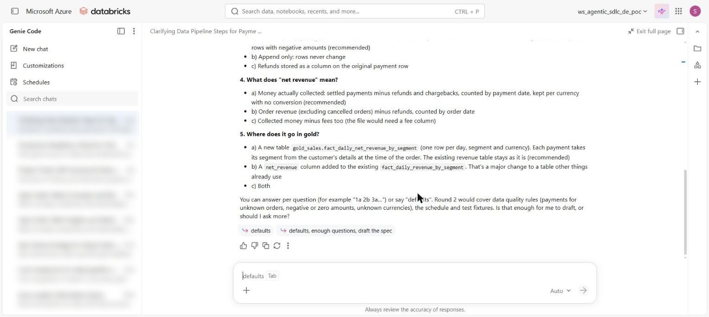

`de-goldfish-review` (new chat): reads only the spec and what it references.
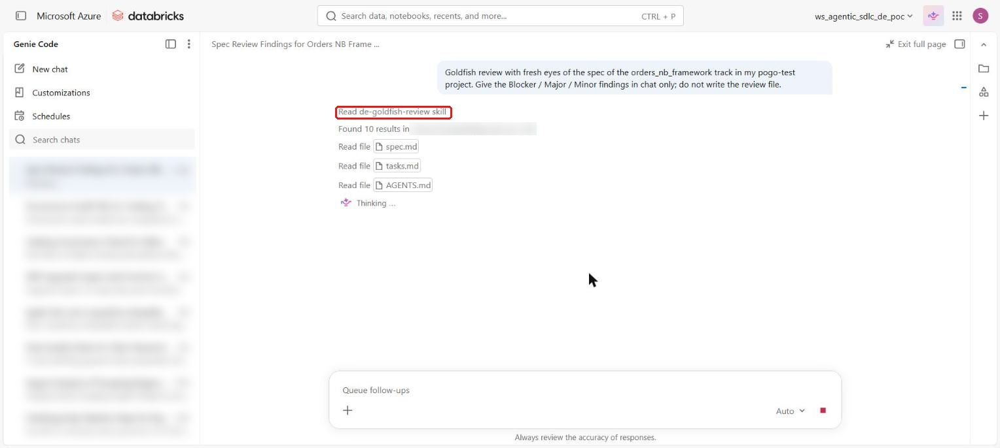
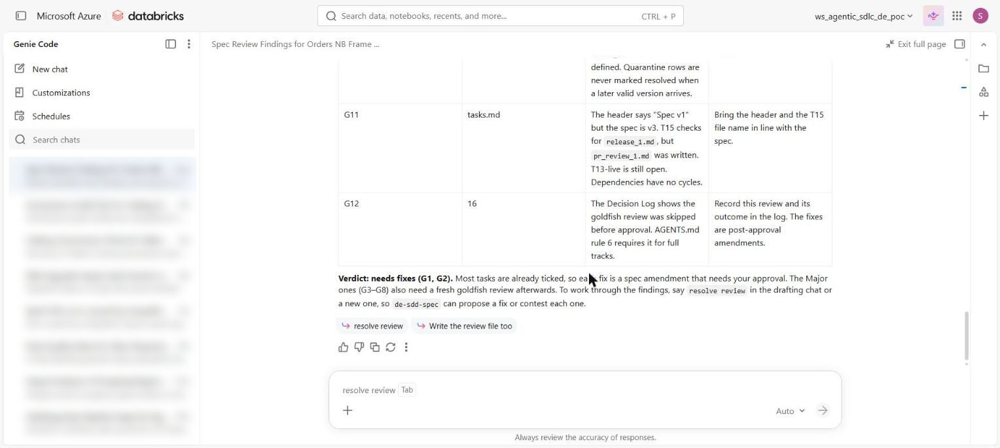

`de-sdd-implement`: names the next task and how it will be checked.
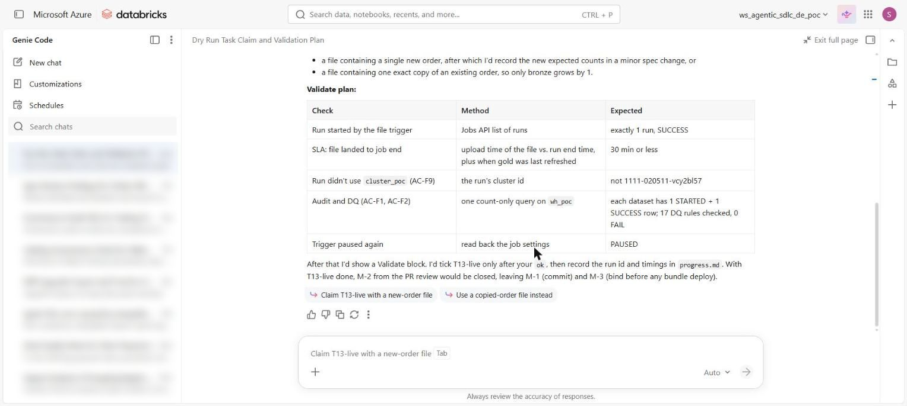

`de-sdd-tracking`: status, what is left, who did what.
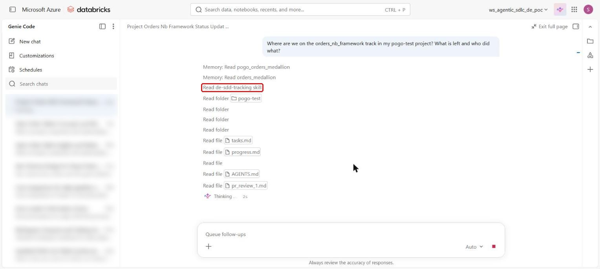

`de-release-gate`: prod scorecard, PASS / WARN / FAIL per area.
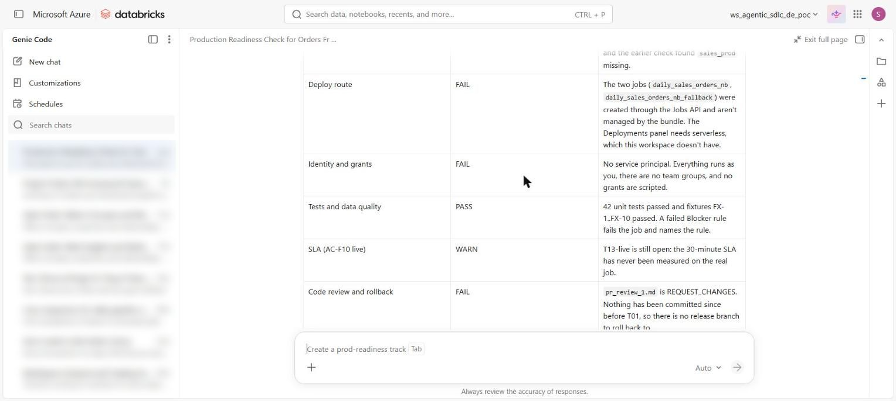

### Design and govern
`de-data-modeling`:
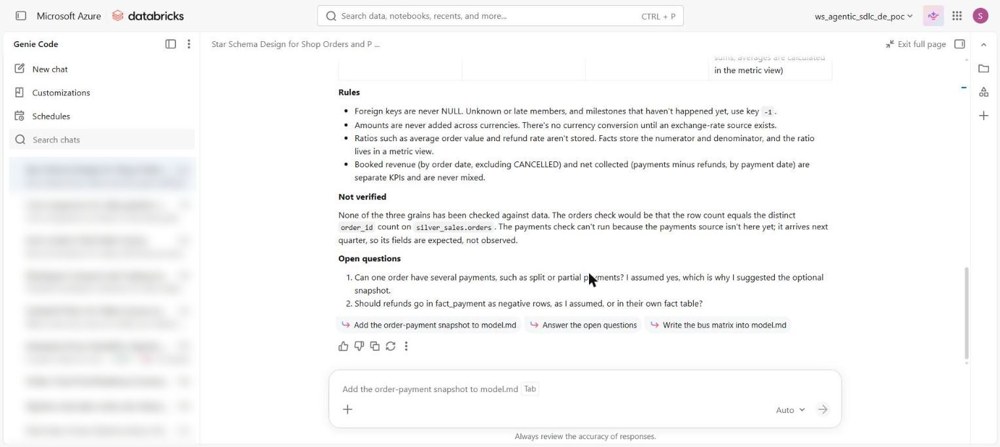

`de-ontology-design` (with an Allow prompt showing the full SQL before it runs):
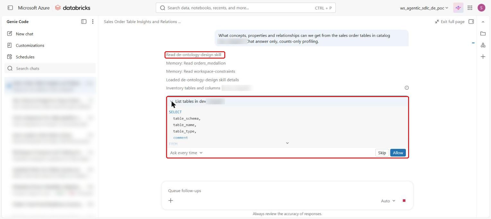

`de-data-governance`:
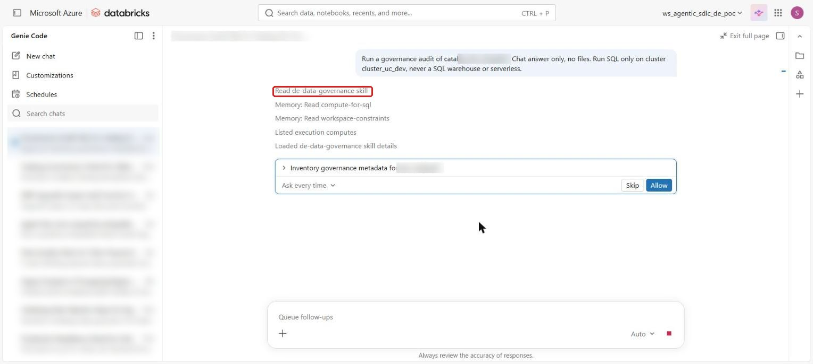
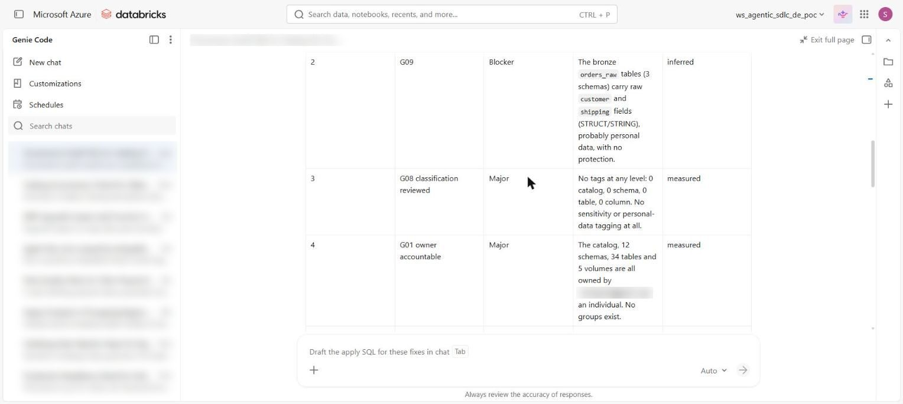

`de-data-contract`:
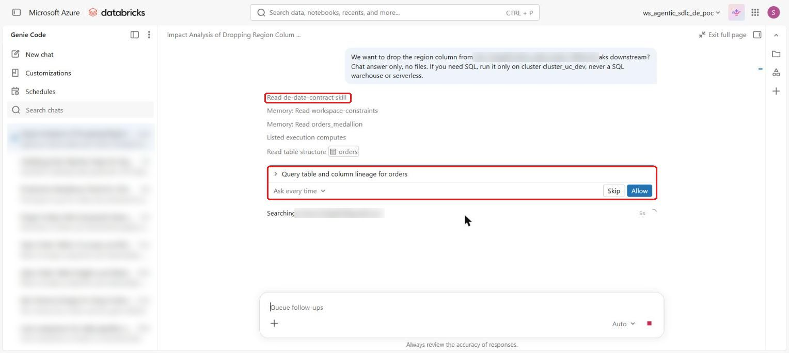

`de-quality-testing`:
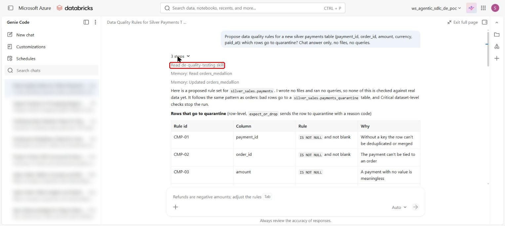

### Choose, cost and run
`de-env-check`:
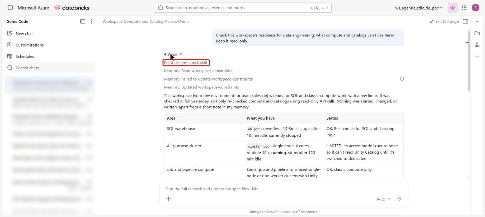

`de-advisor`:
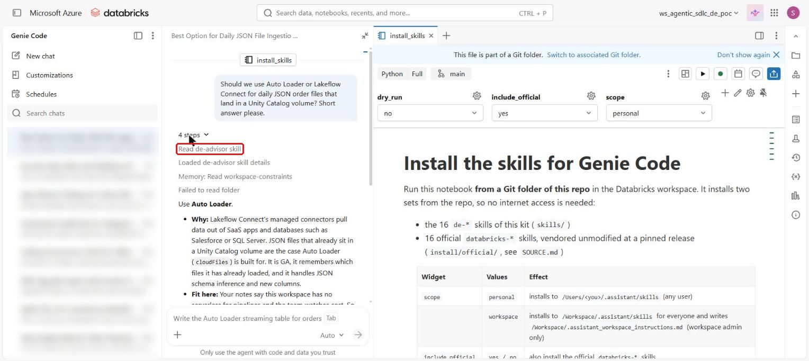

`de-cost`:
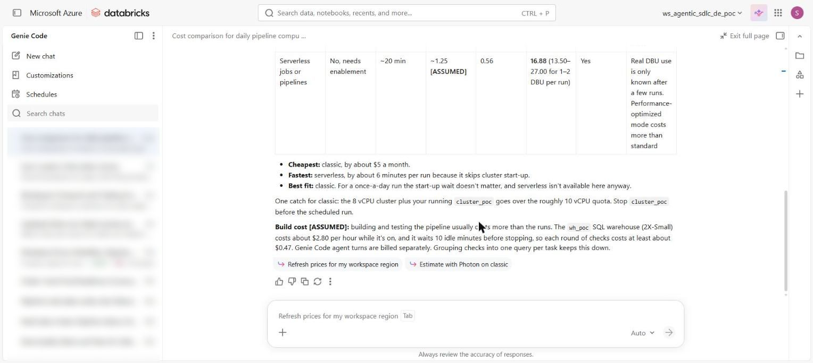

`de-spark-runtime`:
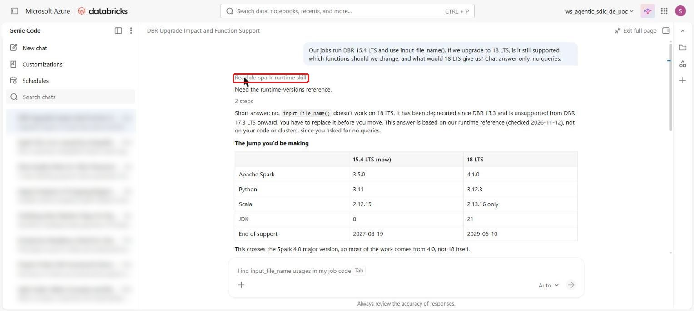

`de-databricks-current`:
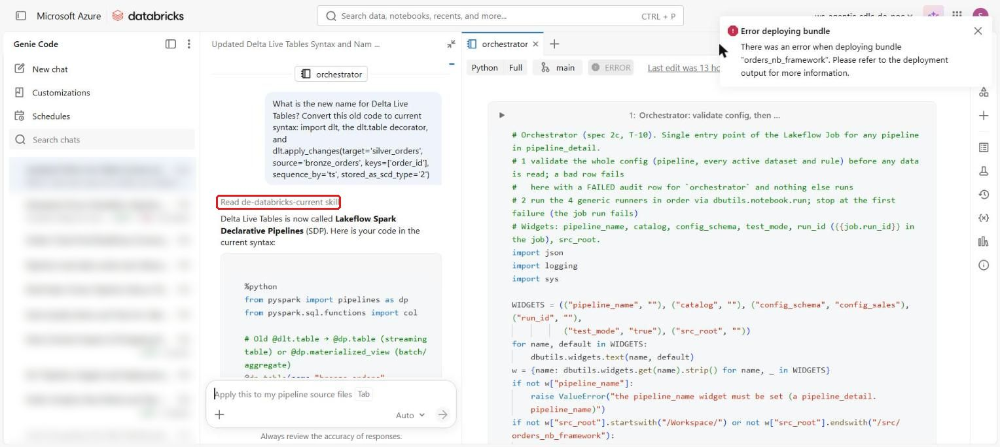

## What the test changed in the skills

| Found | Fixed in |
|---|---|
| `de-advisor` did not load for "A or B?" questions | description rewritten with concrete A-or-B examples (0.5.2); retest passed |
| `de-data-governance` did not load for "which tables have no description" | description lists plain questions (0.1.2); retest passed |
| `de-env-check` and `de-release-gate` suggested "the CLI" when serverless is missing | rule: only workspace routes (serverless, or SDK / Jobs API jobs) (0.4.1, 0.6.2) |
| `de-ontology-design` sent about 12 queries, each needing Allow | at most three batched cells (0.1.2) |
| a query ran on a no-isolation cluster and failed (`UC_NOT_ENABLED`) | skills use the compute you name, else a Unity Catalog-capable one |
| `de-run-diagnose` not loaded for a simple pasted error | description strengthened (0.6.1); still answered without it, so use `@de-run-diagnose` (tip above) |
